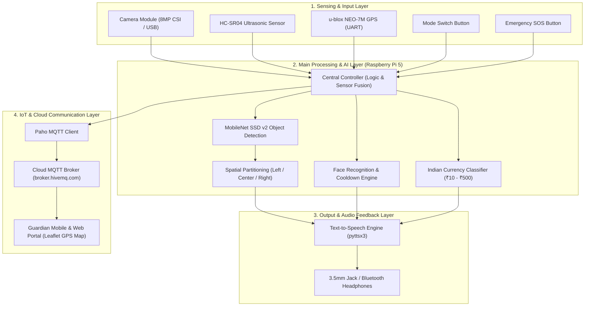
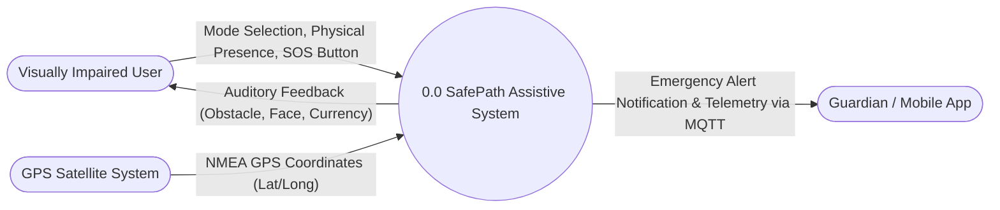
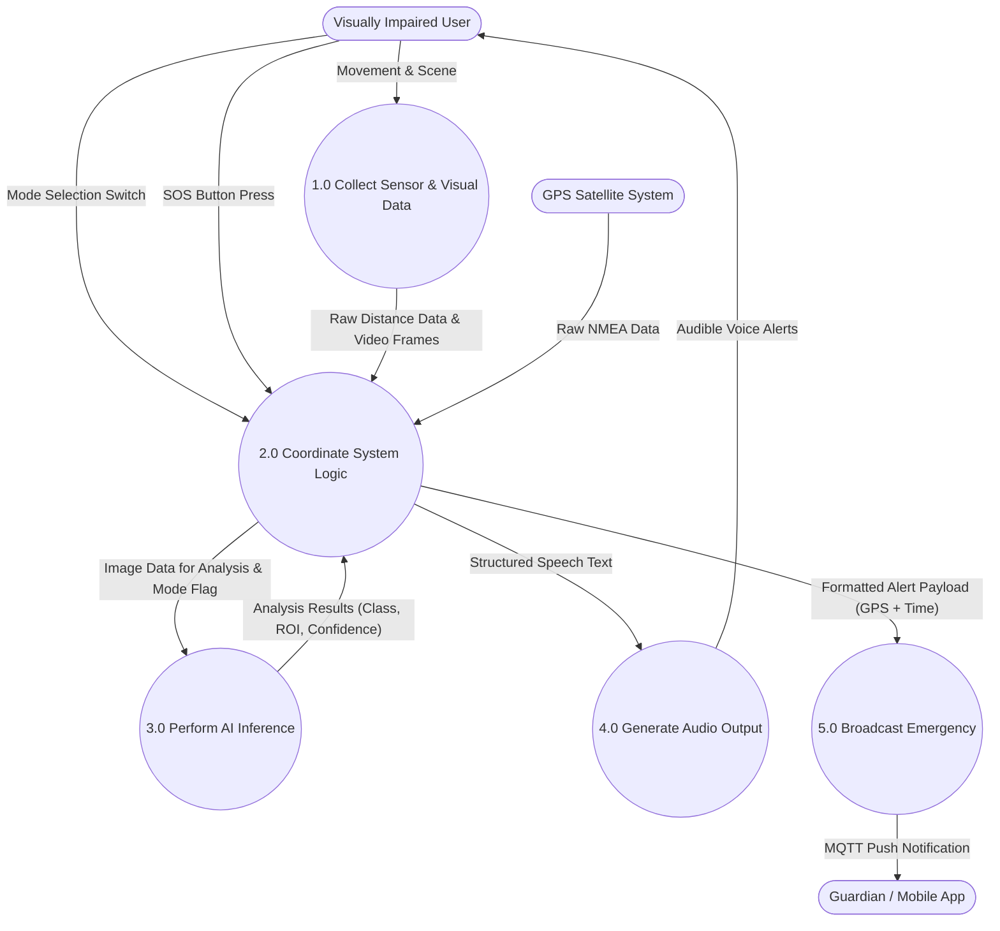
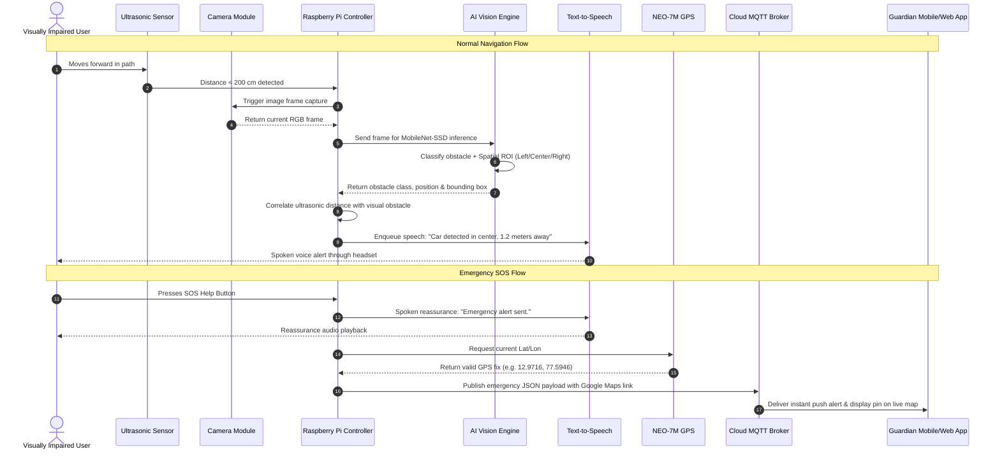

# SafePath System Architecture & UML Documentation

This document provides a comprehensive technical overview of the **SafePath AI Wearable Assistive System for the Visually Impaired**, detailing system layers, Data Flow Diagrams (DFD Level 0 & Level 1), Sequence Diagrams, Use Case representations, and the complete Data Dictionary.

---

## 1. System Block Diagram

---

## 2. Level-0 Data Flow Diagram (Context Diagram)

The Level-0 Context DFD models SafePath as a single central process interacting with external entities:
- **Visually Impaired User**: Provides physical movement, mode selection, and SOS help button presses; receives real-time audio guidance.
- **GPS Satellite System**: Supplies continuous NMEA positioning sentences.
- **Guardian / Mobile Application**: Receives real-time telemetry, location updates, and emergency push alerts.

---

## 3. Level-1 Data Flow Diagram (DFD)

The Level-1 DFD breaks down internal processing into 5 interconnected sub-processes:
1. `1.0 Collect Sensor & Visual Data`
2. `2.0 Coordinate System Logic (Raspberry Pi)`
3. `3.0 Perform AI Inference (SSD, Face, Currency)`
4. `4.0 Generate Audio Output (TTS)`
5. `5.0 Broadcast Emergency (MQTT)`

---

## 4. Sequence Diagram (Closed-Loop Operation)

---

## 5. Complete Data Dictionary

| Data Name | Description | Source | Destination | Data Type / Format |
| :--- | :--- | :--- | :--- | :--- |
| **Physical Presence / Movement** | Indicates movement of user triggering proximity sensing | Visually Impaired User | `1.0 Sensor & Visual Collection` | Boolean / Event |
| **Mode Selection** | User-selected operating mode (`OBJECT_DETECTION`, `FACE_RECOGNITION`, `CURRENCY_DETECTION`) | Visually Impaired User | `2.0 Coordinate System Logic` | String / Enum |
| **Raw Distance Data** | Distance measurements of obstacles ahead | HC-SR04 Ultrasonic Sensor | `2.0 Coordinate System Logic` | Float (cm) |
| **Video Frames** | Live captured environment frames | Camera Module | `2.0 Coordinate System Logic` | Image Frame (RGB array) |
| **Focused Images** | Cropped Region of Interest (ROI) | `2.0 Coordinate System Logic` | `3.0 AI Inference` | Image Tensor |
| **Analysis Results** | Detection results (class, confidence, ROI bbox) | `3.0 AI Inference` | `2.0 Coordinate System Logic` | Structured JSON / Dataclass |
| **Object Type** | Identified obstacle class (person, car, bike, dog, etc.) | `3.0 AI Inference` | `2.0 Coordinate System Logic` | String |
| **Relative Position** | Obstacle direction with respect to user (`left`, `center`, `right`) | `2.0 Coordinate System Logic` | `4.0 Audio Output (TTS)` | String |
| **Estimated Distance** | Approximate proximity from user | `2.0 Coordinate System Logic` | `4.0 Audio Output (TTS)` | Float (meters) |
| **Emergency SOS Signal** | Immediate help signal triggered by tactile button | Visually Impaired User | `2.0 Coordinate System Logic` | Hardware Interrupt Event |
| **GPS Fix Coordinates** | Latitude, Longitude, Altitude, Satellites count | u-blox NEO-7M GPS | `2.0 Coordinate System Logic` | NMEA Decimal Degrees |
| **Formatted Alert Data** | JSON emergency payload with map URL & timestamp | `2.0 Coordinate System Logic` | `5.0 Broadcast Emergency` | JSON Object string |
